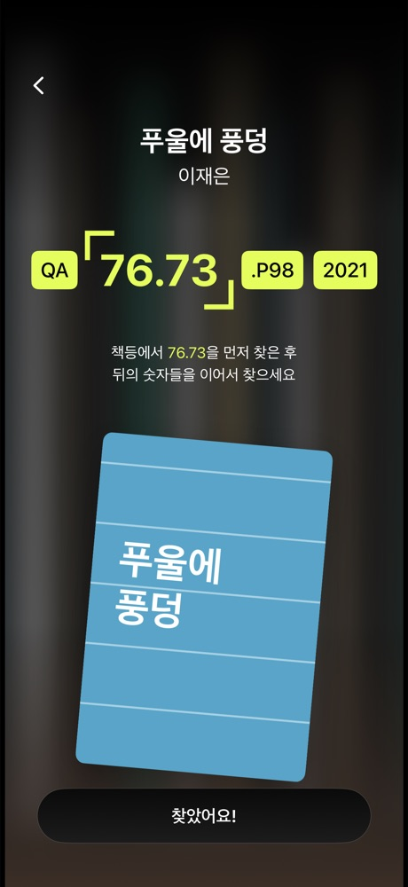
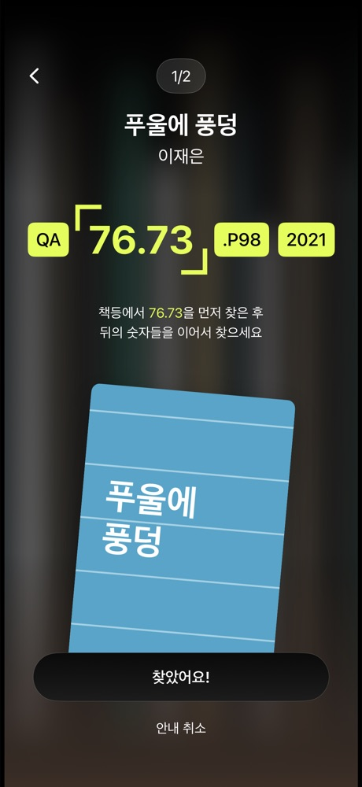

# 도착 화면 디자인 (#133)

2026-10-29 인수한 단권·여러 권 화면을 기준으로 도착 화면을 구성한다.

- 중앙 책 제목·저자, 청구기호 칩, 첫 분류 숫자의 모서리 강조, 책등 찾기 설명, 5도 기울어진 표지, 하단 버튼을 표시한다.
- 여러 권에서는 현재 방문 순서/전체 권수를 표시한다. 단권에서는 진행 배지를 표시하지 않는다.
- 사용자가 확인한 문구에 따라 중간 책도 **찾았어요!**로 표시한다. 중간 책은 기존 `onContinue`, 마지막 책은 기존 `onFinish`로 연결한다.
- 중간 책의 안내 취소는 하단 보조 버튼으로 배치한다. 뒤로가기는 진행 중인 길안내 화면으로 복귀한다.
- 청구기호는 `BookNavigationBookInfo`가 현재 서가와 대조한 소장본만 사용한다. 형식이 다르면 원문을 표시하고, 정보가 없으면 확인 필요 상태를 표시한다.
- 긴 정보·작은 화면·큰 글씨에서는 세로 배치와 스크롤로 모든 정보를 확인할 수 있다. 하단 행동 버튼은 고정한다.

서가 배경은 원본 사진 에셋이 제공되지 않아 SwiftUI Canvas로 책등을 그리고 흐림·그라디언트를 적용했다.
표지는 기존 `BookCoverView`를 사용한다. 아래 캡처의 파란 표지는 외부 네트워크 없이 검증하기 위해 그린 **테스트 전용 이미지**다.

| 단권 | 여러 권 중간 |
| --- | --- |
|  |  |

## 검증

iPhone 18 Pro / iOS 27.0 시뮬레이터에서 확인했다.

- `BookNavigationArrivalCallNumberTests`: 분류·숫자·나머지 기호 보존 5건, 구조를 알 수 없는 값 5건.
- `BookNavigationBookInfoTests`: 서가별 소장본 필터링, 누락 정보, 유효하지 않은 인덱스 3개 테스트.
- `BookNavigationArrivalScreenTests`: 단권, 중간, 마지막, 청구기호 누락, 320×568, 접근성 글씨 크기 6개 상태의 렌더링·문자 표시 확인.
- `BookNavigationFeatureTests`와 `BookNavigationLibraryGuidanceTests`: 다음 책·완료·취소·위치 안내 회귀 16개 테스트 통과.

전체 기본 스킴은 이번에 수정하지 않은 `BookDetailTests/BookBasketIsolationTests.swift:20,26`의
`BookBasketItem`에 대한 main actor 격리 `Equatable` 오류로 테스트 빌드가 중단된다.
검증할 때는 기본 스킴을 임시 복사해 `Testables`에서 `BookDetailTests`만 제외하고 위 테스트를 실행했다.
화면 테스트와 안내 상태 테스트는 별도 실행했다. 임시 스킴은 커밋하지 않는다.

자동 도착 판정, 장바구니 제거·보존, 완료·취소 후 앱 화면 전환은 이번 디자인 변경에 포함하지 않는다.
관련 버튼의 기능 명세는 #134, #135, #136에서 각각 확인한다.
