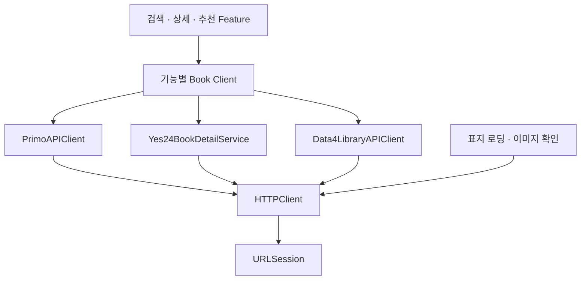

# 도서 API 통신 구조

도서관·Yes24·정보나루의 HTTP 전송은 `Clients/Network/HTTPClient.swift`에서 실행한다.
각 API는 요청 주소·인증·API별 응답 규칙을 관리하고, 기능 Client는 요청 목적과 도서 모델 변환을 관리한다.



## 점검 결과와 변경 범위

- 기준 `dev`의 `aae6f8d`에는 실제 HTTP 전송 코드가 9곳에 있었다. 일반 검색·첫 추천·맞춤 추천은 같은 Primo 검색 엔드포인트의 주소·공통 쿼리·인증을 각각 구성했다.
- 일반 검색·추천·소장 조회는 `PrimoAPIClient`를 사용한다. 검색어, 자료 유형, offset, limit은 호출 목적에 따라 명시적으로 전달한다.
- 정보나루의 연관 도서·표지 메타데이터 조회는 `Data4LibraryAPIClient`를 사용한다.
- 기존 Yes24 서비스는 공통 HTTP 전송기를 사용한다. 상품 없음·서비스 오류·요청 ISBN과 다른 판본 처리는 기존 서비스에서 유지한다.
- 표지 다운로드와 추천 후보 이미지 확인도 공통 전송 경계를 사용한다. 로컬 이미지 파일은 기존 로컬 읽기를 유지한다.
- Feature에서 사용하는 Client 인터페이스와 기존 폴더 위치는 유지한다. HTTP 전송의 실행 코드는 한곳으로 모았다.

이 변경은 통신 코드의 중복 제거와 취소 처리의 일관성을 위한 것이다.
검색·추천·소장 조회의 요청 조건은 서로 다르므로, 전송 경로 통합만으로 실제 요청 수나 지연 시간이 감소했다고 판단하지 않는다.
검색·소장·추천·표지 캐시와 진행 중 요청 공유는 각 기존 소유자가 관리한다.

## 계층별 책임

| 계층 | 책임 |
| --- | --- |
| `HTTPClient` | 주입된 전송기 실행, 전송 전후 취소 확인, HTTP 응답인지 검증 |
| `PrimoAPIClient` | 도서관 기본 주소·검색 경로·공통 쿼리·인증 헤더 구성 |
| `Data4LibraryAPIClient` | 정보나루 엔드포인트·쿼리 인증·연관 도서 유형 구성 |
| `Yes24BookDetailService` | Yes24 인증·상품 상세 응답·소개·표지 해석 |
| 기능 Client와 소장 서비스 | 도서 변환·추천 흐름·기능별 오류 및 재시도 정책 |

`HTTPClient`는 HTTP 오류 상태의 본문과 헤더도 반환한다. Yes24의 404 상품 없음과 소장 조회의 429·5xx 재시도를 API 계층에서 해석하기 위해서다.
공통 계층은 재시도를 추가하지 않는다. 소장 조회는 기존의 최대 3회, `Retry-After`와 대기 시간을 유지한다.
`BookHoldingsClient`의 Debug 직접 인증과 Release HTTPS 프록시 선택도 유지한다.

검색·추천의 후속 책임 분리와 담당 파일별 점검은 [BookDependencyReview.md](BookDependencyReview.md)에 정리했다.

## 의존성 주입과 검증

앱의 기능 Client와 표지 파이프라인은 `@Dependency(\.httpClient)`로 공통 전송기를 읽는다.
독립 서비스는 `HTTPClient`를 인자로 받을 수 있고, 기존 `Yes24BookDetailService(load:)`와 소장 서비스의 `session:` 테스트 주입도 유지한다.

`BookDetailTests/HTTPClientTests.swift`는 취소 전 요청 차단·취소 후 결과 차단·HTTP 응답과 전송 오류 보존을 확인한다.
`BookDetailTests/BookAPITransportTests.swift`는 세 제공자가 같은 주입 전송기를 사용하는지, 인증 정보와 Primo 페이지·자료 유형이 보존되는지 확인한다.

실제 HTTP 검증은 기존 Postman 시뮬레이션을 사용한다.

- `book-cover-fallback`: 기존 `Scripts/verify-book-cover-fallback.sh`로 실행한다. 실제 서비스·공통 전송·표지 모델의 로컬 HTTP 동작을 검사한다.
- `primo-holdings`: `postman/simulations/primo-holdings/primo-holdings.context.md`의 실행 방법을 따른다. 공통 전송·소장 응답 변환·재시도 횟수를 검사한다.

시뮬레이션은 구성된 응답에 대한 클라이언트 동작을 검증한다. 실서버의 현재 응답·실제 프록시 운영 상태는 별도 확인 대상이다.

## 2026-10-30 검증 결과

- iOS 27.2 시뮬레이터에서 앱·테스트 빌드와 관련 테스트 **180개 / 35개 suite**가 통과했다.
- 공통 HTTP·API 요청·Yes24 응답을 검증하는 Foundation 소스 사본의 Swift 6 테스트 **17개 / 4개 suite**도 통과했다.
- Postman 소장 조회 시뮬레이션에서 요청 12건, 표지 시뮬레이션에서 요청 11건을 확인했다. 소장 조회의 401·잘못된 JSON·503 재시도 상한·429 회복, 표지 대체 조회의 9개 경로와 요청 횟수 검사가 통과했다.
- 최초 책 테스트 실행은 202개 중 199개 통과, 3개 실패였다. `BookBasketTests.addFromDetailOverLimit`, `addFromSearchOverLimit`, `BookDetailFeatureTests.dismissDetail`은 `date.now` 테스트 의존성이 설정되지 않아 실패했다. 비밀 파일을 제외한 `dev` 사본에서도 같은 3개 실패를 재현했다. 최종 180개 실행에서는 이들이 속한 두 suite를 제외했다.
- 기존 `BookBasketIsolationTests.swift`의 `BookBasketItem.Equatable` MainActor 격리 컴파일 오류는 빌드 설정의 `EXCLUDED_SOURCE_FILE_NAMES`로 제외했다. 제품 코드와 해당 테스트 파일은 수정하지 않았다.
- 현재 SDK와 SwiftSyntax 사전 빌드 모듈의 불일치는 별도 임시 빌드 경로에서 사전 빌드를 잠시 끄고 패키지를 재해석해 검증했다. 프로세스 종료 후 기존 Xcode 설정을 복원했다.
- 전체 책 테스트가 모두 통과한 상태는 아니다. 위 기존 테스트 문제와 실제 제공자·Release 프록시 운영 검증은 별도로 남아 있다.

## 변경 검토 기록

```text
검토한 commit: aae6f8d831a943877c1f7cbd0cfee530a57b0778 기반 커밋 전 작업 트리
비교 대상: dev / aae6f8d831a943877c1f7cbd0cfee530a57b0778
영향도: L
변경 목적: 도서관·Yes24·정보나루와 표지의 HTTP 전송 경계를 통합한다.
영향 범위: 검색·상세·추천·소장·표지의 통신 경로. 도서 모델과 저장 형식은 변경하지 않는다.
판정 근거: 여러 기능과 제공자가 같은 새 전송 경계를 사용해 통신 실패의 영향이 여러 기능에 걸친다.
확인하지 못한 사항: 실서버·실제 Release 프록시 운영 상태. 전체 테스트의 기존 실패·컴파일 제외는 위 기록 참조.
AI 리뷰 결과: needs_human_review
필수 수정 사항: 이번 변경에서 확인된 필수 수정 사항 없음. 기존 테스트 문제와 최종 필수 CI 기준 확인이 필요하다.
검증 근거: iOS 관련 180개·Foundation 17개 테스트, 기존 HTTP 시뮬레이션 2개, dev 실패 비교 실행, git diff --check
AI 승인: not_applicable
사람 코드리뷰: pending
사람 승인: pending
사람 리뷰·승인 근거: 아직 PR·사람 리뷰 없음
merge 경로: human_merge
merge 조건 판정: blocked
자동 merge 판정: blocked
판정 이유: L 변경으로 사람 리뷰·승인이 필요하고, 전체 테스트 문제와 필수 검증 조건이 남아 있다. commit·push·merge는 수행하지 않았다.
```
